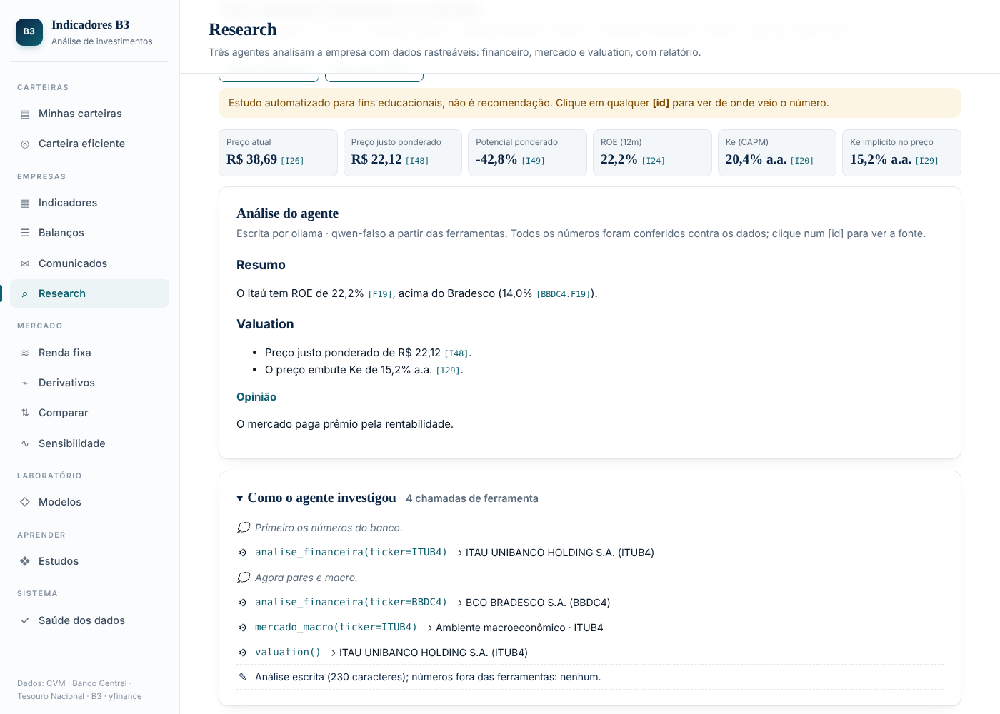
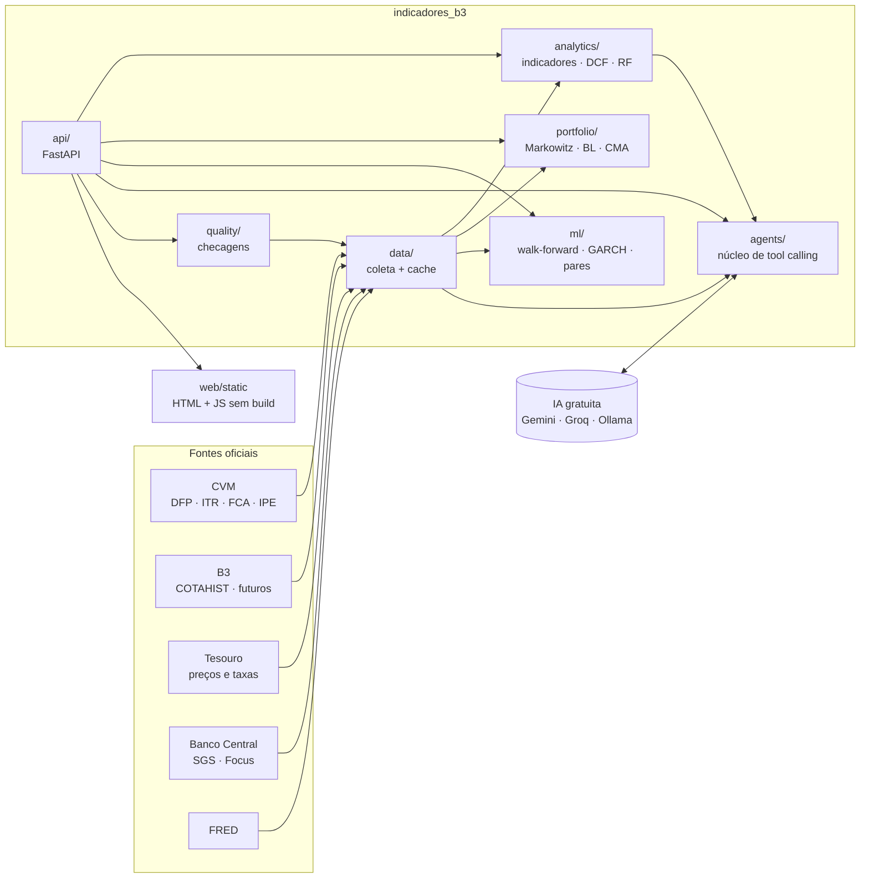
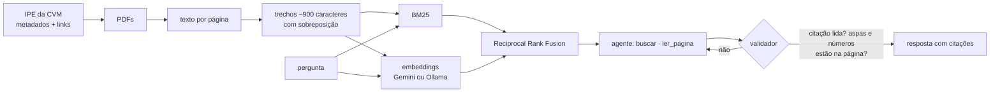
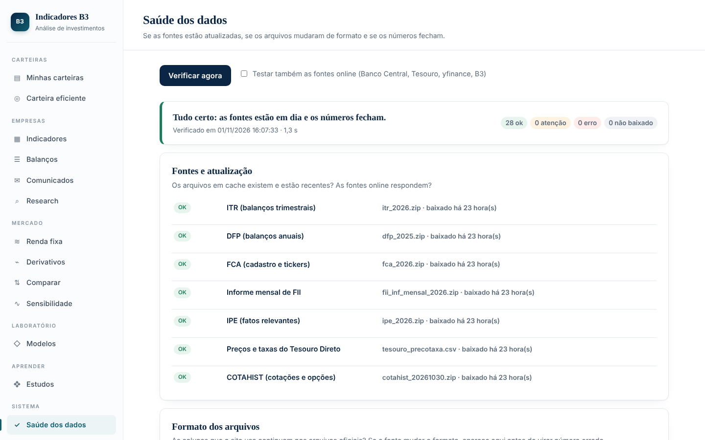

# Indicadores B3

[](https://github.com/<seu-usuario>/indicadores-b3/actions/workflows/ci.yml)

Plataforma local e gratuita de análise de investimentos na B3 com **agentes de IA** e **modelos de machine learning** avaliados fora da amostra. Todos os números saem de fontes oficiais e são **rastreáveis**: cada valor mostra o documento, a conta, o período e a fórmula de onde veio.

> Projeto educacional. Nada aqui é recomendação de investimento.



## Destaques

| Área | O que faz |
|---|---|
| **Setores** | Cada ação classificada pelo setor que a companhia declara à CVM (FCA), agrupado em macrossetores. O seletor de ativos filtra por setor e o agente usa o setor para escolher os pares de comparação. |
| **Indicadores** | P/L, P/VP, ROE, DY, EV/EBITDA e outros, com a conta CVM de cada número. Trata bancos (plano de contas próprio), units e ações informadas em milhares. |
| **Cara ou barata?** | No detalhe de cada ação: P/L ou P/VP contra a própria história (fins de ano da DFP), contra os pares do setor e contra o preço justo (DCF, ou P/VP justificado em bancos). Regra explícita de ±15%. Junto, o gráfico de preço (1, 5, 10 anos ou máximo) com proventos e comparação com o Ibovespa. |
| **Balanços** | DRE e balanço com análise vertical e horizontal. DCF com WACC (β semanal ajustado, ERP, Kd implícito), convenção de meio de ano, cenários e Monte Carlo das premissas. |
| **Carteira eficiente** | Markowitz com Ledoit-Wolf, CAPM e SML, premissas de mercado (CMA), Black-Litterman, HRP, bootstrap, VaR/CVaR e lista de compras. |
| **Agente de carteira** | Investiga por que a carteira ficou abaixo do Ibovespa como num projeto de ML: vê só o **treino** (60% do período), formula hipóteses (cortar quem puxou, trocar por par do setor, BOVA11…), testa cada uma em 3 janelas e confirma até 3 na **reserva** (40% finais, nunca vista). O código impõe as regras (renda fixa intocável, peso máximo, uma confirmação) e o critério de aprovação é fixo. Sem IA, regras fixas viram as hipóteses. |
| **Modelos (ML)** | Carteira robusta em walk-forward e GARCH(1,1) contra volatilidade histórica, avaliados **fora da amostra** e comparados com uma referência simples. Isolation Forest para achar dados contábeis atípicos (Saúde dos dados). |
| **Documentos (RAG)** | Pergunte aos fatos relevantes, comunicados e relatórios de resultados da CVM: coleta dos PDFs, tabelas extraídas linha a linha (rótulo + período + valor, com pdfplumber), busca híbrida (BM25 + embeddings com Reciprocal Rank Fusion), respostas com citação [D12 p3] conferida contra a página e um painel de avaliação (recall@k, MRR, aprovação no validador, alucinações barradas, tokens) para comparar versões e provedores. |
| **Research (agentes)** | Agente de IA com ferramentas (tool calling) que investiga, compara pares, faz o valuation de bancos (P/VP justificado), monta cenários e escreve a tese separando fatos, estimativas e opinião. Lê também os relatórios de resultados que a empresa entrega à CVM (relatório gerencial, press-release, apresentação) para o que os demonstrativos não trazem, como inadimplência de 90 dias e Basileia, citando a página [D12 p3]. |
| **Histórico de acertos** | Cada conclusão (cara ou barata, Research, propostas do agente de carteira) é guardada com a data e conferida a 3, 6 e 12 meses: retorno total contra o Ibovespa, ou da proposta contra a carteira atual. Mostra taxa de acerto, taxa base e a diferença entre os grupos, com aviso de amostra pequena. |
| **Estudos** | Mais de 60 artigos sobre os conceitos usados no site, com quadros "Como o mercado faz". |
| **Qualidade de dados** | Checagens automáticas de formato, consistência e atualização das fontes, painel *Saúde dos dados* e um agente que investiga anomalias. |

## Resultados medidos

Números gerados por `python -m indicadores_b3.resultados`, com amostra e limitações em [`docs/resultados.md`](docs/resultados.md):

- **Validador do agente:** em 9 execuções reais, reprovou 7 de 14 rascunhos por números sem fonte; 7 execuções terminaram com texto aprovado e 2 caíram para o texto por regras. 8 de 9 precisaram trocar de provedor de IA no meio da conversa.
- **Carteira robusta (walk-forward, 994 dias fora da amostra):** nenhum otimizador ganhou da carteira de pesos iguais em Sharpe (0,19). O Markowitz clássico teve a pior queda (−25,8% contra −18,3%) e os pesos mais instáveis; mínima variância e HRP giraram bem menos.
- **GARCH(1,1) × volatilidade histórica:** menor perda (QLIKE) em 4 de 5 ações; perdeu onde o teste inclui um choque de −29% num dia.
- **RAG:** a avaliação salva ainda é preliminar (perguntas geradas sem IA, 3 perguntas de resposta) e não sustenta conclusão.

As decisões de arquitetura e seus tradeoffs estão em [`docs/decisoes/`](docs/decisoes/).

### Módulos de apoio, ainda em revisão

Os agentes usam os cálculos de renda fixa (curva do Tesouro e CDI), que não têm tela própria nesta versão. O código está em `analytics/` e `data/` porque os agentes dependem dele, mas ainda está sendo conferido contra fontes externas.

## Arquitetura



### Como o agente de pesquisa funciona

1. O modelo recebe o pedido e **decide** quais ferramentas chamar:
   - `analise_financeira` e `empresas_do_setor`: empresa e pares;
   - `mercado_macro`: juros, inflação, Focus e comunicados;
   - `valuation`: comparação com pares, cenários e sensibilidade;
   - `relatorios_ri` e `ler_pagina_ri`: relatórios de resultados entregues à CVM, com citação da página;
   - `detalhe_item`: fórmula e insumos de um número.
2. As ferramentas são funções Python determinísticas que leem as fontes oficiais. **A IA não cria números.**
3. O texto final passa por um **validador**, que confere cada número e sua unidade contra os resultados das ferramentas. Se aparecer um número inventado, o texto volta para a IA corrigir. Se ela insistir, o texto é descartado.
4. O laço tem várias proteções:
   - troca de provedor quando um limite gratuito acaba;
   - novas tentativas com backoff;
   - orçamento de passos e de tempo;
   - reaproveitamento de chamadas repetidas;
   - erros de ferramenta devolvidos ao modelo em vez de derrubar o laço.
5. A tela mostra **cada passo da investigação** e cada número tem um link para a fonte.

Os detalhes estão em [`src/indicadores_b3/agents/README.md`](src/indicadores_b3/agents/README.md).

### RAG dos comunicados, com avaliação



| Métrica | O que mede |
|---|---|
| recall@k e MRR | se a busca traz o trecho certo entre os k primeiros, com perguntas geradas por IA a partir de trechos sorteados (sem rótulo manual), comparando BM25, semântica e híbrida |
| aprovadas pelo validador / na 1ª tentativa | respostas cujas citações existem e cujas aspas e números batem com as páginas citadas |
| rascunhos barrados | alucinações pegas pelo validador antes de chegar ao usuário |
| contém esperado / recusa correta | conferência contra as perguntas escritas à mão em `data/evals/perguntas.jsonl` |
| tempo e tokens | custo de cada provedor (Gemini × Groq × Ollama) |

## Começando

Requisitos: Python 3.10 ou mais recente.

```bash
git clone https://github.com/<seu-usuario>/indicadores-b3.git
cd indicadores-b3
python -m venv .venv
# Windows: .venv\Scripts\activate   |   Linux/macOS: source .venv/bin/activate
pip install -e ".[dev]"
python -m indicadores_b3          # ou: indicadores-b3  (no Windows: duplo clique em iniciar.bat)
python -m indicadores_b3.conferir # confere cada fonte e função com dados reais (Windows: conferir.bat)
```

Abra <http://127.0.0.1:8080>. No menu lateral, **Direto** mostra só números e decisões (as explicações ficam em "ⓘ Saiba mais") e **Estudo** mostra todas as explicações. Na primeira consulta, os arquivos públicos da CVM, da B3 e do Tesouro são baixados para `data/cache_cvm/`. Depois disso, o site funciona inclusive sem internet, usando esse cache.

### IA gratuita (opcional)

O agente funciona com qualquer um destes provedores. Nenhum exige cartão de crédito:

| Provedor | Como obter | Observação |
|---|---|---|
| Gemini (Google AI Studio) | chave em <https://aistudio.google.com/apikey> | nível gratuito com limites por minuto e por dia; os dados enviados podem ser usados pelo Google |
| Groq | chave em <https://console.groq.com/keys> | nível gratuito com limites |
| Ollama | <https://ollama.com> + `ollama pull qwen2.5:7b` | roda localmente, sem limite, mas é mais fraco |

Configure as chaves na aba **Research → Configurar IA gratuita** ou pelas variáveis de ambiente (veja [`.env.example`](.env.example)). As chaves ficam em `data/config_ia.json`, que é ignorado pelo Git. Sem nenhum provedor, o modo **Regras fixas** gera o relatório sem IA.

## Estrutura do projeto

```
indicadores-b3/
├── src/indicadores_b3/
│   ├── config.py          # pastas de dados, porta e variáveis de ambiente
│   ├── api/app.py         # FastAPI: endpoints + site estático
│   ├── data/              # CVM, B3, Tesouro, BCB, yfinance (reserva), cache
│   ├── analytics/         # demonstrações, DCF, indicadores, renda fixa, impostos
│   ├── portfolio/         # Markowitz, premissas (CMA), Black-Litterman, montagem
│   ├── rag/               # coleta dos PDFs da CVM, tabelas, busca híbrida e avaliação
│   ├── ml/                # carteira robusta, GARCH, pares/anomalias (funções puras testáveis)
│   ├── agents/            # núcleo de tool calling, provedores de IA, agentes de pesquisa e qualidade
│   ├── quality/           # checagens de formato, consistência e atualização
│   └── web/static/        # front-end (HTML/CSS/JS, sem build)
├── tests/                 # pytest: fórmulas, ML, agentes, dados reais (pulados sem cache)
├── docs/
├── .github/workflows/ci.yml
└── pyproject.toml
```

## Fontes de dados

| Fonte | Uso | Acesso |
|---|---|---|
| [CVM, dados abertos](https://dados.cvm.gov.br/) | DFP, ITR, FCA, IPE, informe de FII | arquivos públicos |
| [B3](https://www.b3.com.br/) | COTAHIST (cotações e opções), ajustes de futuros | arquivos públicos |
| [Tesouro Transparente](https://www.tesourotransparente.gov.br/) | preços e taxas do Tesouro Direto | CSV público |
| [Banco Central](https://dadosabertos.bcb.gov.br/) | SGS (Selic, IPCA, PTAX…) e Focus | APIs públicas sem chave |
| [FRED](https://fred.stlouisfed.org/) | juros e inflação dos EUA | CSV sem chave |
| yfinance | preços e proventos (reserva) | não oficial |

## Qualidade e testes

```bash
ruff check src tests      # lint
pytest -q                 # testes
```

- **Testes sem internet** (rodam no CI):
  - fórmulas financeiras;
  - ML com dados sintéticos: o walk-forward não olha o futuro, os resultados são reproduzíveis pela semente e o GARCH recupera os parâmetros de um processo GARCH simulado;
  - robustez dos agentes: falhas de ferramenta, troca de provedor, backoff, validador e limite de passos.
- **Testes com dados reais:** usam os arquivos de `data/cache_cvm` e conferem, entre outras coisas, que os balanços fecham, que as DREs fecham e que os preços do Tesouro batem com os publicados. São pulados quando o cache não existe.
- **CI:** o GitHub Actions roda lint e testes em Python 3.10 a 3.13.



## Limitações conhecidas

- A CVM não publica inadimplência de 90 dias, índice de Basileia nem lucro recorrente dos bancos. Esses dados aparecem como "ausentes", com a indicação da fonte (IF.data do BCB ou RI de cada banco).
- Depois da Resolução CMN 4.966 (2025), comparações de provisão para perdas com anos anteriores não são diretas.
- O yfinance não é uma fonte oficial e é usado só como reserva. Quando ele falha, os preços vêm do COTAHIST da B3.
- Os níveis gratuitos de IA têm limites que podem mudar a qualquer momento.

## Licença

Defina a licença antes de publicar (por exemplo, MIT). Sem um arquivo `LICENSE`, o código não pode ser reutilizado por terceiros.
